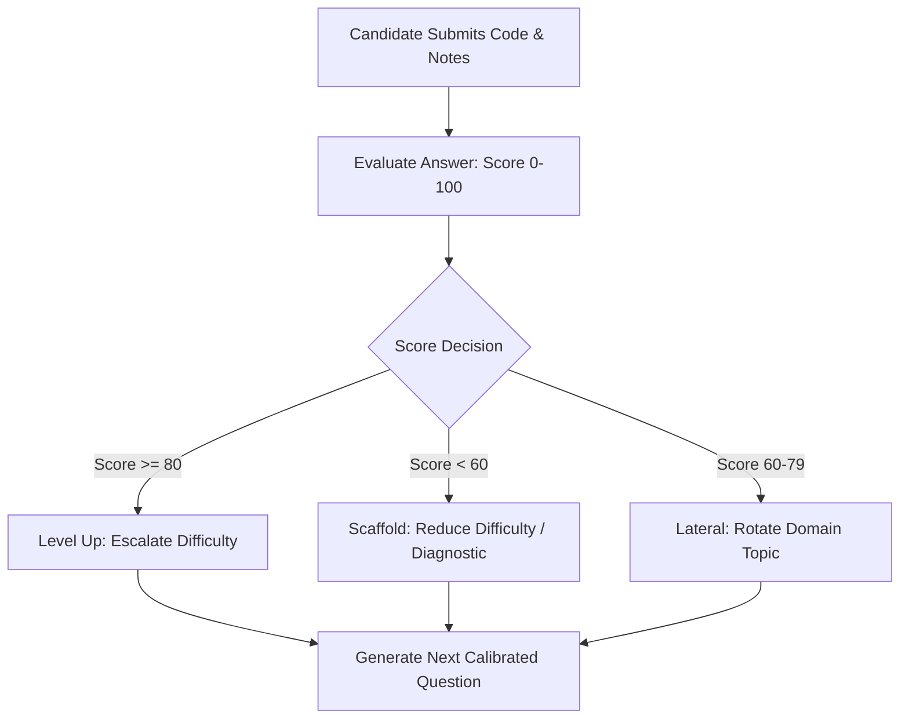

# AI Engineering & Model Strategy

This document outlines the architecture, prompt engineering techniques, structured generation contracts, and fault-tolerance patterns powering the AI Coding Interview Platform.

---

## 1. Local-First Model Inference Strategy

### Why Local Ollama?
- **Zero Cost (₹0 / $0):** Unlimited question generation, live chat, and comprehensive candidate evaluation without recurring third-party API bills.
- **Privacy & IP Protection:** Proprietary candidate solutions, candidate speech transcripts, and corporate questions remain 100% on-premises.
- **Standardized Vercel AI SDK Integration:** Leverages `@ai-sdk/openai` configured with `baseURL: http://localhost:11434/v1`, making the inference layer completely swappable with cloud providers (OpenAI, Anthropic, Gemini) with zero UI code refactoring.

```typescript
// src/utils/ai/ollama.ts
import { createOpenAI } from '@ai-sdk/openai'

export const ollama = createOpenAI({
  baseURL: process.env.OLLAMA_BASE_URL || 'http://localhost:11434/v1',
  apiKey: 'ollama', // Ollama does not require an API key
})
```

---

## 2. Structured LLM Generation vs. Freeform Text

LLMs are inherently probabilistic text predictors. For mission-critical workflows (session state transitions, dynamic scoring, schema persistence), freeform markdown parsing is unreliable.

### 2.1. Zod Schema Enforcement (`generateObject`)
We use Vercel AI SDK's `generateObject` powered by JSON schema modes. Every output must conform to strict TypeScript-validated Zod schemas:

1. **Question Generation Schema (`singleQuestionSchema`):**
   - Requires `question` (string), `hints` (array of 2–3 strings), and `expectedConcepts` (array of strings).
2. **Evaluation Schema (`evaluationSchema`):**
   - Requires `score` ($0 \le x \le 100$), `feedback` (detailed prose), `strengths` (array), `improvements` (array), and `verdict` (`'strong_hire' | 'hire' | 'weak_hire' | 'no_hire'`).

```typescript
const result = await generateObject({
  model: ollama.chat('llama3.2'),
  schema: singleQuestionSchema,
  prompt: `Generate an adaptive coding interview question...`,
})
```

---

## 3. Real-Time Streaming Socratic Dialogue

### Low-Latency Streaming (`streamText`)
In an interview context, waiting 5–15 seconds for an LLM to generate an entire thought creates awkward silence and breaks user flow.

Using `streamText` with Next.js App Router:
- Tokens are streamed incrementally to the client using standard HTTP chunked transfer.
- Time-To-First-Token (TTFT) drops to $< 800\text{ms}$ on local machines.
- The candidate sees the interviewer's words materialize in real time.

### Socratic Interviewer System Persona
The system prompt strictly prevents the model from acting as a "code generator" or "homework solver":
```text
INTERVIEWER BEHAVIOR & GUIDELINES:
1. Speak in a constructive, encouraging, but rigorous professional tone.
2. If the candidate asks clarifying questions about requirements, scale, or constraints, clarify them thoughtfully as a real interviewer would.
3. If the candidate is stuck or asks for direction, guide them with progressive hints or probe their understanding.
4. CRITICAL: NEVER write the complete solution code for the candidate, even if asked directly. Challenge them to implement the logic themselves.
5. Keep your responses concise (1-3 paragraphs) so the candidate can quickly resume coding without reading walls of text.
```

---

## 4. Adaptive Difficulty Engine & Feedback Loops

Rather than static question batches, questions are generated **dynamically one at a time** based on candidate performance on preceding questions:



1. **Escalation ($\ge 80\%$):** Tests technical boundaries, concurrency, and scaling edge cases.
2. **Scaffolding ($< 60\%$):** Shifts to targeted diagnostics and fundamental algorithmic primitives.
3. **Lateral Shift ($60–79\%$):** Preserves difficulty tier while pivoting topic domain (e.g., from Data Structures to System Design).

---

## 5. Fault Tolerance & Deterministic Fallback Resilience

Local inference models can encounter resource spikes, CPU contention, or transient service restarts. Under no circumstance should a candidate's live interview crash or hang indefinitely.

### Fallback Guarantee:
If the local Ollama process fails or times out:
1. The error is caught gracefully in `src/lib/adaptive/engine.ts`.
2. A curated, difficulty-calibrated deterministic question is generated in $< 5\text{ms}$ matching the candidate's target topic and difficulty.
3. The interview continues seamlessly with zero data loss or session deadlocks.

```typescript
try {
  const result = await generateObject({ ... })
  return result.object
} catch (error) {
  console.warn('Ollama encountered an issue, deploying deterministic fallback:', error)
  return getDeterministicFallbackQuestion(targetTopic, targetDifficulty)
}
```
This behavior is rigorously validated in our automated regression suite (`src/lib/adaptive/__tests__/engine.test.ts`).
