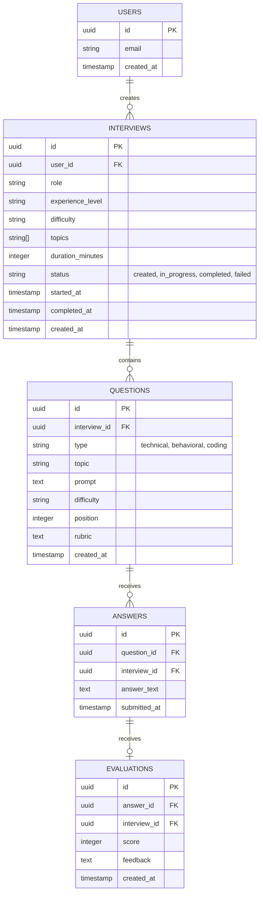

# Database Design

This document outlines the relational database schema used in the AI Coding Interview Platform. We use PostgreSQL (via Supabase).

## Entity Relationship Diagram (ERD)

## Schema Details

### 1. `users` Table
Managed entirely by Supabase Auth (`auth.users`). We do not need to create a custom users table unless we want to store public profiles, but for the MVP, the auth table is sufficient.

### 2. `interviews` Table
Tracks a specific interview session.
- **Row Level Security (RLS):** Users can only `SELECT`, `INSERT`, `UPDATE` rows where `user_id = auth.uid()`.

### 3. `questions` Table
Stores the questions generated by Ollama.
- **Row Level Security (RLS):** Users can only access questions if the linked `interview_id` belongs to them.

### 4. `answers` Table
Stores the user's responses.
- **Row Level Security (RLS):** Users can only access answers if the linked `interview_id` belongs to them.

### 5. `evaluations` Table
Stores Ollama's assessment of the user's answers.
- **Row Level Security (RLS):** Users can only access evaluations if the linked `interview_id` belongs to them.

## Security (Row Level Security)
Because the frontend connects directly to Supabase in some architectures, we must enforce Row Level Security (RLS) so that a malicious user cannot query `SELECT * FROM interviews` and see another user's data.
