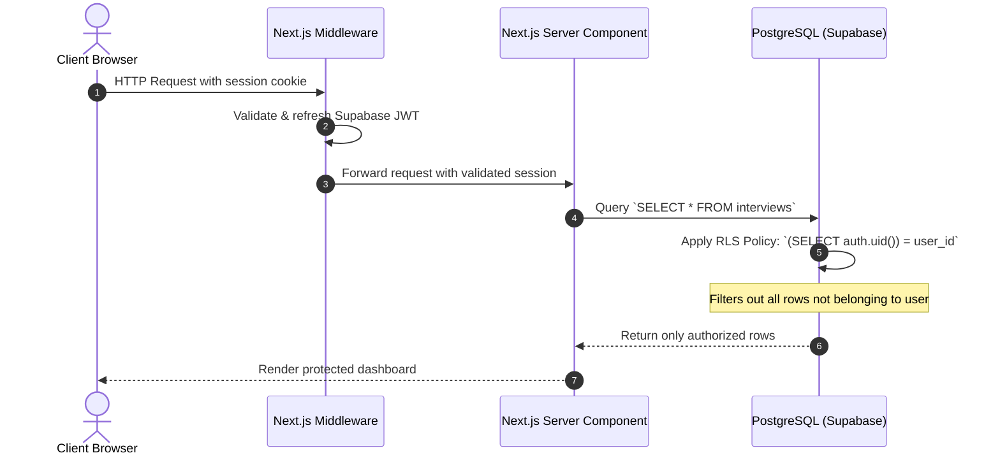

# Technical Interview Preparation Guide

This document captures technical interview questions, conceptual deep-dives, architectural decisions, and interview-ready explanations directly derived from building this AI Coding Interview Platform.

Use this guide to prepare for technical interviews and articulate engineering decisions with confidence.

---

## Table of Contents
1. [AI Engineering & Model Integration](#1-ai-engineering--model-integration)
2. [Database Architecture & PostgreSQL Internals](#2-database-architecture--postgresql-internals)
3. [Authentication, Authorization & Security](#3-authentication-authorization--security)
4. [Full-Stack Architecture & Next.js App Router](#4-full-stack-architecture--nextjs-app-router)

---

## 1. AI Engineering & Model Integration

### Q1: Why does `@ai-sdk/openai` work with Ollama even though Ollama is not OpenAI?

#### **Short Answer (Elevator Pitch):**
Ollama natively exposes an HTTP compatibility layer matching the OpenAI REST API specification at `/v1/chat/completions`. Because `@ai-sdk/openai` communicates over standard HTTP using this schema, simply pointing its `baseURL` to `http://localhost:11434/v1` allows the official OpenAI client to interact seamlessly with local models with ₹0 API cost and 100% privacy.

#### **Technical Deep-Dive:**
* **Industry Standard Protocol:** The OpenAI API format (request payloads with `messages: [{ role, content }]` and streaming Server-Sent Events chunks) became the de facto standard in AI engineering.
* **Why not dedicated Ollama SDKs?** Unofficial community wrappers (like `ollama-ai-provider`) often lag behind major framework releases (e.g. Vercel AI SDK v7's `LanguageModelV4` specification) or introduce conflicting peer dependencies. Using `@ai-sdk/openai` guarantees first-party type safety and stability.
* **How to explain in an interview:**
  > *"When choosing model integrations, I avoided unmaintained community wrappers by utilizing Ollama's built-in OpenAI API compatibility layer. By pointing Vercel's first-party `@ai-sdk/openai` provider to Ollama's `/v1` endpoint on localhost, we get complete type safety, native streaming, and structured outputs while keeping models running 100% locally on device."*

---

### Q2: Why is `generateObject` preferred over asking the LLM in plain text to "please output JSON"?

#### **Short Answer:**
Freeform text prompts asking for JSON frequently fail in production due to markdown fencing (````json ... ````), conversational commentary, missing fields, or malformed syntax. `generateObject` pairs schema validation (via Zod) with provider-level structured decoding (e.g. grammar-constrained sampling or JSON mode), guaranteeing that the output is parsed and strictly typed before reaching application logic.

#### **Failure Modes of Prompt-Only JSON:**
1. **Markdown Formatting Leakage:** Models often prepend `Here is your JSON:` or wrap payloads in backticks.
2. **Schema Drift:** A model might return `"hints": "hint 1"` as a string instead of an array of strings.
3. **Partial Output Failure:** Truncated tokens produce syntax errors in `JSON.parse()`.

#### **How `generateObject` Solves This:**
```typescript
const result = await generateObject({
  model: ollama.chat('llama3.2'),
  schema: z.object({
    question: z.string(),
    hints: z.array(z.string()),
    expectedConcepts: z.array(z.string()),
  }),
  prompt: 'Generate a medium difficulty interview question about React...',
})
// result.object is strictly typed and guaranteed valid
```

---

### Q3: Why centralize the AI client in `src/utils/ai/ollama.ts`?

#### **Short Answer:**
Centralizing the provider follows the **Single Responsibility Principle** and enables **Dependency Inversion**. API routes consume a shared `ollama` abstraction rather than creating ad-hoc HTTP clients. If we switch from local Ollama to a cloud provider (e.g. Groq, OpenAI, or AWS Bedrock) in production, only one configuration file changes.

---

## 2. Database Architecture & PostgreSQL Internals

### Q4: Why must Foreign Key columns be indexed manually in PostgreSQL?

#### **Short Answer:**
While PostgreSQL automatically creates unique B-tree indexes for Primary Keys, it **never** automatically creates indexes on Foreign Key columns. Failing to index foreign keys causes slow `JOIN` operations and forces full sequential table scans and heavy locking during `ON DELETE CASCADE` actions.

#### **Technical Mechanics:**
* When deleting an interview:
  ```sql
  DELETE FROM public.interviews WHERE id = '...';
  ```
* Because `questions` references `interviews(id)` with `ON DELETE CASCADE`:
  * **Without index on `questions.interview_id`:** PostgreSQL must perform a **Sequential Scan** on the entire `questions` table to find matching rows.
  * **With index `idx_questions_interview_id`:** PostgreSQL uses an **Index Scan**, locating and deleting child records in logarithmic $O(\log N)$ time.

---

### Q5: Why wrap `(SELECT auth.uid())` as a scalar subquery instead of raw `auth.uid()` in RLS policies?

#### **Short Answer:**
Calling `auth.uid() = user_id` executes `auth.uid()` as a volatile function **once for every single row scanned**. Wrapping it as `((SELECT auth.uid()) = user_id)` forces the PostgreSQL query planner to evaluate the function **once per query** and treat the result as a constant scalar, providing a **10x to 100x performance improvement** on large tables.

#### **Comparison:**
```sql
-- ❌ Inefficient (Function called N times, where N = table row count)
CREATE POLICY "Users can view interviews" ON interviews
    FOR SELECT USING (auth.uid() = user_id);

-- ✅ Optimized (Evaluated once, cached per statement execution)
CREATE POLICY "Users can view interviews" ON interviews
    FOR SELECT USING ((SELECT auth.uid()) = user_id);
```

---

### Q6: Why does the `questions` table enforce `ON DELETE CASCADE` from `interviews`?

#### **Short Answer:**
To maintain strict **referential integrity**. A question cannot exist without a parent interview session. If an interview is deleted, `ON DELETE CASCADE` ensures the database engine automatically removes all associated questions, answers, and evaluations atomically in a single transaction, preventing orphaned records.

---

## 3. Authentication, Authorization & Security

### Q7: What is the difference between Authentication and Authorization in this architecture?

#### **Short Answer:**
* **Authentication (AuthN):** *"Who are you?"* Handled by Supabase Auth (`auth.users`). Verifies the user's email and password, creates a cryptographic session, and issues a JWT stored in HTTP-only cookies.
* **Authorization (AuthZ):** *"What are you allowed to access or mutate?"* Handled by PostgreSQL **Row-Level Security (RLS)** in the database. Verifies whether the authenticated `auth.uid()` has permission to read or modify specific rows in `interviews`, `questions`, etc.

#### **Request Flow Diagram:**


---

### Q8: If a malicious user attempts to query question ID `xyz`, how does RLS protect the data?

#### **Short Answer:**
RLS operates at the PostgreSQL database kernel level, not in application code. Even if a user crafts a direct request querying `SELECT * FROM questions WHERE id = 'xyz'`, PostgreSQL intercepts the query and enforces the policy:

```sql
EXISTS (
    SELECT 1 FROM public.interviews
    WHERE interviews.id = questions.interview_id
      AND interviews.user_id = (SELECT auth.uid())
)
```

If the parent interview does not belong to the user's `auth.uid()`, the query returns zero rows (`404` or empty result) without leaking data or throwing an unhandled database error.

---

## 4. Full-Stack Architecture & Next.js App Router

### Q9: Why use Next.js App Router Server Components instead of a traditional React Single Page Application (SPA)?

#### **Short Answer:**
1. **Security & Zero Credential Leakage:** Server Components execute exclusively on the server. Database queries and AI provider logic run without exposing private endpoints, tokens, or business rules to the client bundle.
2. **Reduced JavaScript Bundle Size:** Heavy dependencies (such as AI SDK parsers, markdown engines, database clients) remain on the server and are never downloaded by the user's browser.
3. **Elimination of Waterfall Fetches:** Data is fetched directly on the server before rendering the initial HTML, avoiding the "render empty shell → trigger loading spinner → fetch data" waterfall typical of SPAs.

---

### Q10: How does session management work between Next.js Middleware and Supabase SSR?

#### **Short Answer:**
Next.js uses a hybrid edge/server architecture where Server Components cannot write cookies (only read them). 
* `@supabase/ssr` solves this using `middleware.ts`:
  1. Incoming requests pass through the Next.js middleware.
  2. The middleware calls `supabase.auth.getUser()`, which reads the refresh token from request cookies.
  3. If the access token has expired, Supabase exchanges it for a new one and sets the updated cookie in both the `request` (for downstream Server Components) and the `response` (for the browser).

---

### Q11: Why persist interview sessions in PostgreSQL (`created` → `in_progress` → `completed`) instead of managing state in React client memory?

#### **Short Answer:**
Client-side memory (React `useState`) is volatile. If the candidate accidentally refreshes the browser, loses internet connection, or switches devices, all progress and previous answers are lost. Persisting session state transitions in PostgreSQL provides **durability**, **auditability**, and allows seamless resumption of active interviews.

---

### Q12: How do Next.js Server Actions improve developer experience and security compared to traditional REST API routes?

#### **Short Answer:**
1. **Zero Endpoint Boilerplate:** Instead of creating separate API route handlers (`/api/interview/create`), managing request methods (`POST`), manual JSON parsing, and writing client-side `fetch()` with error states, Server Actions run directly on the server with TypeScript type safety.
2. **Built-in Security:** Server Actions cannot be called by unauthorized third parties without passing through Next.js CSRF tokens and cookies.
3. **Progressive Enhancement:** Works natively with HTML `<form action={...}>`, allowing graceful submission handling without client-side JavaScript hydration lag.

