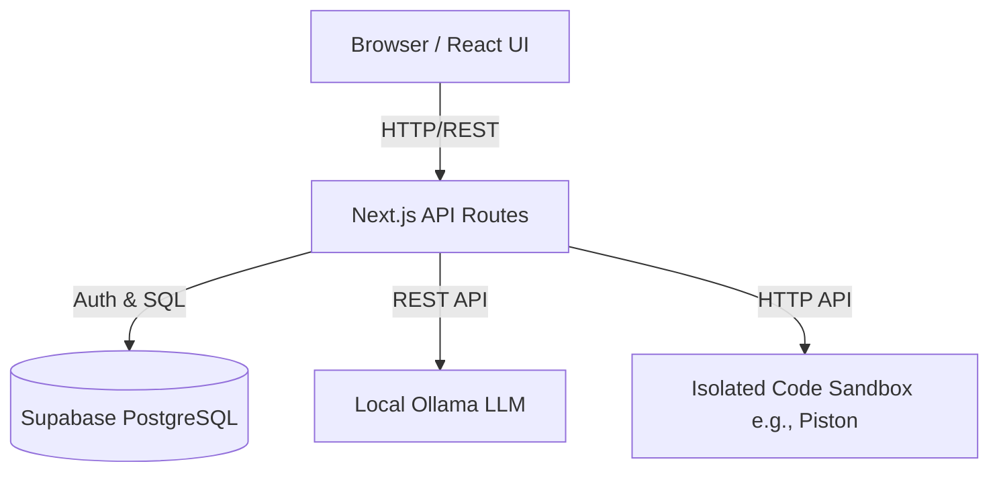

# System Architecture

## High-Level Architecture
The application follows a modular monolith architecture built on the Next.js App Router.

## Component Responsibilities

### 1. Frontend (Next.js React Client)
- Renders the UI using Tailwind CSS.
- Manages local state (timers, current input).
- Handles user authentication flows (via Supabase Auth client).

### 2. Backend (Next.js API Routes)
- Acts as a secure intermediary.
- Validates all incoming requests and user permissions.
- Communicates securely with the database.
- Structures prompts and communicates with the local Ollama instance.

### 3. Database & Auth (Supabase)
- Manages user identities and secure sessions.
- Stores interview configurations, generated questions, user answers, and evaluation reports in PostgreSQL.

### 4. AI Service (Ollama)
- Runs locally.
- Responsible for generating structured JSON responses for interview questions.
- Responsible for evaluating answers based on provided rubrics.

### 5. Code Execution (Future Phase)
- A completely isolated 3rd-party service (e.g., Piston or Judge0) to safely compile and run untrusted user code.
